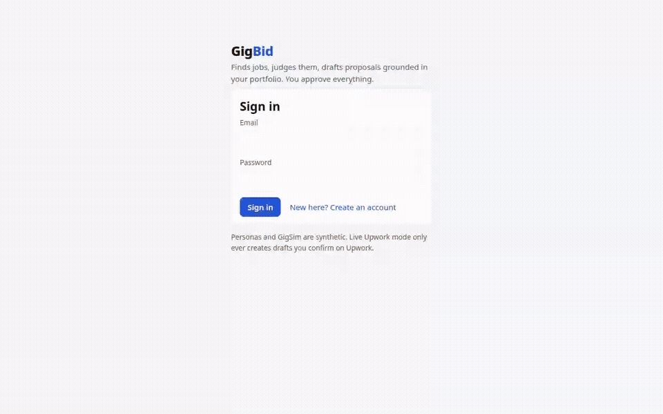
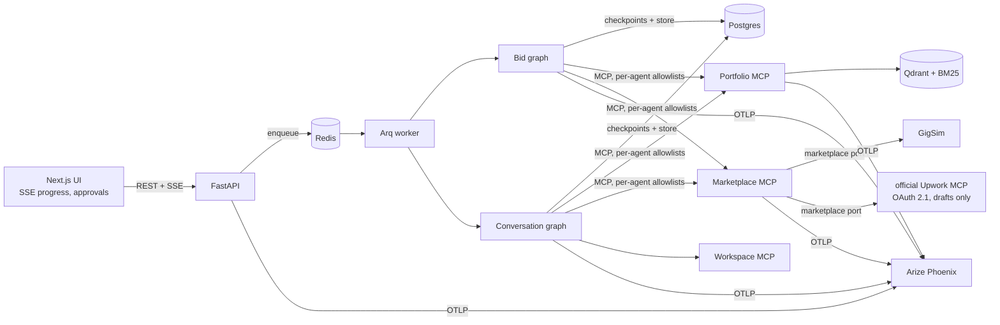

# GigBid: a multi-agent freelancer copilot

GigBid watches a freelance marketplace for you, decides which jobs are worth a bid, writes a proposal in which every
claim cites your own portfolio, and stops before anything is sent: **you approve every proposal and every message**.
It also catches scam posts and instructions hidden inside job posts, and helps you answer clients when they reply.



**Live demo:** given with the submission (served from the author's machine through a free Cloudflare tunnel during demo and grading sessions, `scripts/live_demo.sh`; see [RUNBOOK](docs/RUNBOOK.md#deploy-free-public)) · reviewer login in the private comment on the submission (synthetic full-stack persona; the
marketplace is GigSim, a simulator, so nothing reaches a real client).
**Public traces:** every run page links to its Phoenix trace; the live link publishes Phoenix next to the app

> AI-4016 R&D assignment · Syed Kalbe Raza (22i-0794). Persona data and GigSim are synthetic.

## What it does
1. **Scout** polls saved searches (GigSim, or the official Upwork MCP server in live mode) and queues new jobs.
2. **Job Analyst, Risk Assessor and Fit Matcher** run in parallel: a structured job spec; scam, off-platform and
   prompt-injection screening; and a requirement-to-evidence matrix from the Portfolio MCP server.
3. **Decide** gives an explainable bid / watch / skip; **Pricing** proposes a rate from market statistics, the client's
   budget, your floor and the Connects cost.
4. **Writer → claim verifier → Critic → Compliance Guard** produce a draft whose claims are all backed by evidence ids;
   unsupported claims are removed or rewritten before anyone sees the draft.
5. **Human approval** shows the exact text, price and Connects cost (a dry run); only a signed approval submits it,
   exactly once, even across a worker crash.
6. **Client Liaison** classifies replies, offers interview slots from your calendar and drafts answers behind the same
   approval gate.

## Architecture

Both graphs, the reason each agent exists and the stores are in [docs/ARCHITECTURE.md](docs/ARCHITECTURE.md); every
MCP tool, with its annotations and auth, is in [docs/TOOLS.md](docs/TOOLS.md).

## Results
Every number below is generated from a file in [`evals/results/`](evals/results/) by
`python -m evals.runners.results_table`; CI fails if a README number has no source file.

<!-- RESULTS:START -->
<!-- RESULTS:END -->

**Reading the tables.** The shipped retrieval (requirement decomposition + hybrid BM25/dense) finds the most gold
evidence: Recall@5 {{rag_variants:variants/best/overall/recall@5|.3f}} vs {{rag_variants:variants/v0_naive/overall/recall@5|.3f}} for
naive dense retrieval; the cross-encoder and the outcome prior lowered recall and are off
([ADR 0002](docs/adr/0002-shipped-retrieval.md)). End to end the difference does not reach the reply rate: on
{{gigsim_outcomes_best_openb:summary/proposals}} proposals per arm the intervals overlap, which the
[report](docs/report/GigBid_RnD_Report.pdf) discusses as a negative result. Claim verification removes every unsupported
claim before a human sees the draft ({{gigsim_outcomes_best_openb:summary/unsupported_claims_per_proposal_before|.2f}} → {{gigsim_outcomes_best_openb:summary/unsupported_claims_per_proposal_after|.0f}} per proposal).
Injected instructions: {{injection_asr:summary/asr_before|.0%}} attack success against a naive writer, {{injection_asr:summary/asr_after|.0%}} with GigBid's defences
({{injection_asr:summary/n}} planted attacks). Held-out test set: bid/skip F1 {{decisions_test_never:overall/bid_skip/f1|.2f}}, scam recall
{{decisions_test_never:overall/scam/recall|.2f}}. GigSim's clients are simulated, so reply rates compare configurations; they are not real-world rates.

## Run it
```bash
cp .env.example .env      # add a free Groq key (and optionally OpenRouter); fill the random secrets
make up                   # web :3000 · API docs :8000/docs · Phoenix traces :6006
```
Without containers: `make infra`, then the processes in `Procfile.dev`. `make seed` rebuilds all data from the Kaggle
downloads, `make test` runs unit, contract and MCP tests, `make eval` runs the CI evaluation gate, `make e2e` runs the
Playwright tests. Operations (degraded mode, crash recovery, replay, deployment) are in
[docs/RUNBOOK.md](docs/RUNBOOK.md).

## Use the Portfolio MCP server on your own portfolio
```bash
PORTFOLIO_DIR=~/my-portfolio uvx --from "git+https://github.com/kalbe-raza/gigbid" gigbid-portfolio-mcp
```
Claude Desktop / Cursor configuration and the Docker command: [mcp_servers/portfolio/README.md](mcp_servers/portfolio/README.md).

## Documentation
| | |
|---|---|
| [ARCHITECTURE](docs/ARCHITECTURE.md) | graphs, marketplace port, MCP surface, stores, why each agent exists |
| [TOOLS](docs/TOOLS.md) | MCP tool inventory, annotations, auth, third-party trust rationale |
| [DATA_CARD](docs/DATA_CARD.md) | Kaggle sources and licences, synthetic data, gold labels, splits, limitations |
| [RUNBOOK](docs/RUNBOOK.md) | start, deploy, scheduling and rate limits, failure drills |
| [EXTENSION](docs/EXTENSION.md) | X2 proposal experiments (A/B test with a significance test) |
| [CHANGE_REQUEST](docs/CHANGE_REQUEST.md) | the 2026-11-02 policy update and the diff that absorbed it |
| [ADRs](docs/adr/) | stack, shipped retrieval, models, critic threshold, workspace mock |
| [AI_USAGE](docs/AI_USAGE.md) | how AI assistants were used to build this |

## Pinned versions
Python 3.12 · langgraph 1.2.20 · langgraph-checkpoint-postgres 3.2.0 · langgraph-supervisor 0.0.31 · mcp 1.30.0 ·
langchain-mcp-adapters 0.3.2 · fastapi 0.162.4 · sse-starlette 3.7.0 · pydantic 2.14.3 · psycopg 3.3.8 · arq 0.28.0 ·
qdrant-client 1.20.0 · fastembed 0.9.1 (BAAI/bge-small-en-v1.5) · rank-bm25 0.2.2 · arize-phoenix 11.38.0 ·
arize-phoenix-otel 0.17.3 · openinference-instrumentation-langchain 0.1.83 · Next.js 15.5 · React 19.3 ·
openapi-fetch 0.13 · Playwright 1.56 · images: postgres 16, redis 7, qdrant v1.15.4, ollama 0.12.6. Exact Python
versions are locked in `uv.lock`, web versions in `apps/web/package-lock.json`.

## Résumé bullets
- Built **GigBid**, a LangGraph multi-agent freelancer copilot on three self-built MCP servers plus the official Upwork
  MCP server, with crash-safe, exactly-once human-approved submission; claim verification cut unsupported claims from
  {{gigsim_outcomes_best_openb:summary/unsupported_claims_per_proposal_before|.2f}} to {{gigsim_outcomes_best_openb:summary/unsupported_claims_per_proposal_after|.0f}} per proposal and injected-instruction attacks from {{injection_asr:summary/asr_before|.0%}} to {{injection_asr:summary/asr_after|.0%}} success.
- Ran a 7-variant retrieval study on {{rag_variants:variants/best/overall/n}} labelled jobs (Recall@5 {{rag_variants:variants/v0_naive/overall/recall@5|.2f}} → {{rag_variants:variants/best/overall/recall@5|.2f}}) and a
  paired A/B test in a simulated marketplace; found and fixed a simulator bug that had driven the reply rate to 0%.

## Licences
Code: MIT. Job posts come from public Kaggle datasets (ODC-By / Apache-2.0, attribution in the
[data card](docs/DATA_CARD.md)); personas, clients and GigSim are synthetic.
