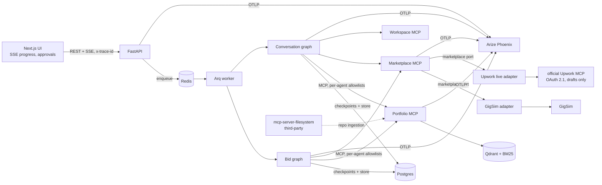

# Architecture

GigBid is a team of LangGraph agents behind a FastAPI API and a Next.js UI. Agents reach the outside world only through
MCP tools; nothing reaches a client until a human approves it in the UI.



## Bid graph (one thread per job)
Rendered from code: [`docs/images/bid_graph.mmd`](images/bid_graph.mmd) (`python -c "from agent.graphs.bid_graph import build_bid_graph; print(build_bid_graph().get_graph().draw_mermaid())"`).

```
intake ─Send─► job_analyst ─┐
       ├─Send─► risk_assessor ├─► decide ─bid─► pricing ─► writer ─► verifier ─► critic ─┬─► compliance ─► dry_run ─► human_approval
       └─Send─► fit_matcher ──┘     │                         ▲                         │        ▲                       │ approve ─► submit ─► finalize
                                skip/watch ─► finalize          └──── revise (max 2) ─────┘        └── apply_edit ◄── edit ┤ reject ─► finalize
```

## Conversation graph (one thread per client conversation)
`load_thread → classify_intent → (interview_request → propose_slots) → draft_reply → message_compliance →
message_approval (interrupt) → send_reply` ([`docs/images/conversation_graph.mmd`](images/conversation_graph.mmd)).

## Why each agent exists

| Agent | Why it is a separate node | Model (open profile) | MCP access |
|---|---|---|---|
| Scout | Scheduling, dedup and queueing are deterministic and must never spend LLM tokens | none | marketplace: search_jobs, get_job |
| Job Analyst | Turns noisy posts into a JobSpec later steps can check against | gpt-oss-20b | none |
| Risk Assessor | Scam / off-platform / injection screening must happen before anything is written; cheapest layer first (patterns → Prompt Guard → LLM only when ambiguous) | Prompt Guard 2 + gpt-oss-20b | marketplace: get_client_history |
| Fit Matcher | Requirement-to-evidence matrix: the evidence the Writer is allowed to use | none (retrieval) | portfolio: search_evidence, list_skills |
| Decide | Explainable bid / watch / skip from config thresholds | none | none |
| Pricing Strategist | Market stats + client budget + floor + Connects value; rule-based so injected prices cannot move it | none | marketplace: get_market_stats, get_connects_balance |
| Proposal Writer | The only free-text generator; sees only cited evidence and "do not claim" list | gpt-oss-120b | portfolio: search_evidence |
| Claim verifier | R5: removes or rewrites unsupported claims before the Critic sees the draft | gpt-oss-20b (only for ambiguous claims) | portfolio: search_evidence |
| Critic | Grounding / personalisation / length / opening; sends back at most twice | Qwen 3.8 27B (different family from the Writer) | portfolio |
| Compliance Guard | Enforces the policy pack on every outgoing text; can block | patterns + gpt-oss-safeguard-20b | none |
| Client Liaison | Intent, interview slots, floor-aware negotiation, same approval gate | gpt-oss-20b / 120b | marketplace (read; write after approval), workspace |

Merges we made and why: the Fit Matcher, decision and pricing are deterministic; R&D C
(`evals/results/rnd_c_architectures.json`) compares this design to a single ReAct agent and a prebuilt supervisor.

## The marketplace port (R1)
`agent/marketplace_port.py` defines one interface; `mcp_servers/marketplace/adapters/{gigsim,upwork_live}.py`
implement it. `marketplace.mode` in config selects the adapter. Graph nodes only call Marketplace MCP tools, so the
graph cannot tell which marketplace is behind them. Live mode only creates drafts the user confirms on Upwork.

## State, execution trace, long-term memory (C2)
- **State** (`agent/state.py`): what one job/conversation needs now; typed; reducers on every field parallel branches
  or loops append to; checkpointed in Postgres (`AsyncPostgresSaver`).
- **Execution trace**: `exec_trace` (every MCP tool name, args, result summary, latency, trace id) + Phoenix spans
  (tokens and cost per node) + the append-only `audit_log` table on the MCP servers. Nodes never read it to decide.
- **Long-term memory** (`agent/memory/`): LangGraph `AsyncPostgresStore`; style rules and outcome insights enter only
  through `promotion_rules.py` (style: same edit pattern ≥3 times on ≥2 jobs; outcome: ≥5 samples and ≥15-point lift).

## Durability and exactly-once (C6)
Approve → the API signs the exact dry-run text and persists the decision on the run (`pending_resume`) → worker
resumes the thread with `Command(resume=...)`. If the API or worker dies in between, the worker's startup sweep
re-enqueues the resume. `submit` uses idempotency keys derived from (thread, draft version) for both the draft and the
submission, so re-running it returns GigSim's stored response instead of submitting or spending Connects again.

## Failure handling (C7)
Per-node timeouts and bounded retries (node wrapper + LangGraph `RetryPolicy`), provider fallback for LLM calls
(Groq → OpenRouter free model), MCP outages raise `MCPUnavailable` → job re-queued with backoff + Redis degraded flag →
UI banner; after 4 failures a run becomes `dead_letter`. Step and token budgets per thread move a thread to
`needs_attention`. GigSim 429s are honoured (Retry-After) and the client-side limiter stays under its limit.

## Stores
Postgres (users, encrypted credentials, inbox, runs, run events, pipeline, approvals, audit log, LangGraph checkpoints
and store), Redis (queue, degraded flag, event cursors), Qdrant (dense vectors; BM25 rebuilt from Qdrant payloads),
Phoenix (traces).
