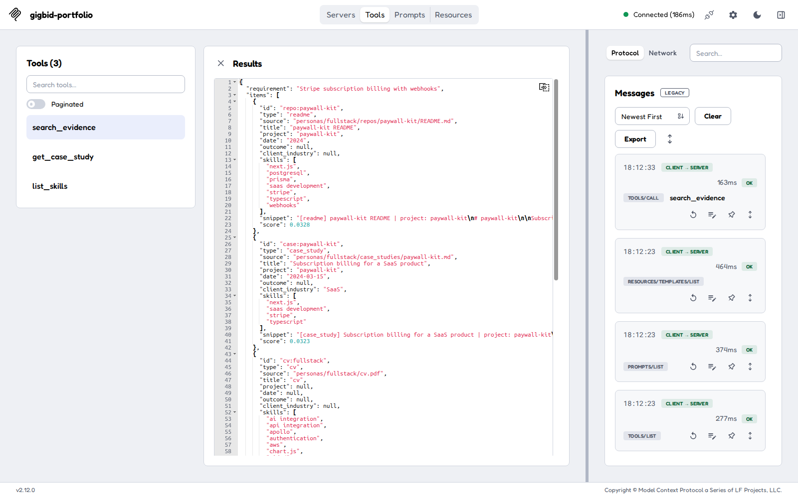

# MCP tool inventory

All agent capabilities are MCP tools. Schemas are snapshotted in `tests/contract/snapshots/*.json`; CI fails if a
signature changes unintentionally. Annotations: RO = readOnlyHint, D = destructiveHint, I = idempotentHint,
OW = openWorldHint.

| Tool | Server | Read / write | Annotations | Auth | Used by |
|---|---|---|---|---|---|
| `search_evidence(requirement, k, filters)` | portfolio | read | RO, I | bearer (HTTP) / none (stdio) | Fit Matcher, Writer, Verifier, Critic, Liaison |
| `get_case_study(case_id)` | portfolio | read | RO, I | bearer / none | Writer |
| `list_skills()` | portfolio | read | RO, I | bearer / none | Fit Matcher |
| resources `portfolio://case/{id}`, `portfolio://proposal/{id}`, `portfolio://repo/{name}`, `portfolio://cv` | portfolio | read | - | bearer / none | MCP hosts (Claude Desktop, Cursor) |
| prompts `answer_screening_question`, `evidence_for_job`, `portfolio_gaps` | portfolio | - | - | - | MCP hosts |
| `search_jobs(query, domain, limit, posted_after)` | marketplace | read | RO, I, OW | bearer + per-user rate limit | Scout |
| `get_job(job_id)` | marketplace | read | RO, I, OW | bearer | Scout/intake, Liaison |
| `get_client_history(client_id)` | marketplace | read | RO, I, OW | bearer | Risk Assessor |
| `get_connects_balance()` | marketplace | read | RO, I, OW | bearer | Pricing |
| `get_market_stats(domain)` | marketplace | read | RO, I, OW | bearer | Pricing |
| `get_policy()` | marketplace | read | RO, I, OW | bearer | Pricing (policy-aware Connects) |
| `list_messages()` | marketplace | read | RO, I, OW | bearer | Liaison, pipeline sync |
| `list_proposals()` / `list_events(since)` | marketplace | read | RO, I, OW | bearer | pipeline sync |
| `create_proposal_draft(..., idempotency_key, dry_run, approval_token)` | marketplace | **write** | D=false, I, OW | bearer + **signed human approval** unless dry_run | dry_run node, submit node |
| `submit_proposal(proposal_id, idempotency_key, dry_run, approval_token)` | marketplace | **write (spends Connects)** | **D=true**, I, OW | bearer + signed approval | submit node |
| `send_message(thread_id, text, idempotency_key, dry_run, approval_token)` | marketplace | **write** | D=false, I, OW | bearer + signed approval | Liaison (after approval) |
| `list_free_slots(days_ahead, duration_minutes, max_slots)` | workspace | read | RO, I | bearer | Liaison |
| `create_interview_hold(start, end, title, idempotency_key)` | workspace | write (tentative) | D=false, I | bearer | Liaison (after approval) |
| `create_email_draft(to, subject, body, idempotency_key)` | workspace | write (draft only) | D=false, I | bearer | Liaison |
| Upwork official MCP (`https://mcp.upwork.com/mcp`) - job search, job details, proposal drafts, messages | third-party | read; writes are drafts confirmed on Upwork | provider-defined | **OAuth 2.1 + PKCE**, tokens encrypted per user | Marketplace server's `upwork_live` adapter |
| `@modelcontextprotocol/server-filesystem` - `directory_tree`, `read_multiple_files` | third-party | read | provider-defined | stdio, rooted at the repos directory | repository ingestion (`rag/ingest/repo_mcp.py`) |

Every marketplace write carries an idempotency key (a retried call never submits or spends twice), has a `dry_run`
mode that returns exactly what would be sent and what it costs (the approval screen shows it), and requires an HMAC
approval token the API signs only when the user clicks Approve on that exact content. Every call is written to the
append-only `audit_log` table (user, tool, masked arguments, result, trace id); UPDATE/DELETE are rejected by trigger.

## Third-party servers: one-line trust rationale
- **Upwork official MCP server** - operated by the marketplace itself, OAuth 2.1 with per-user consent, and every
  write is a draft the user must confirm on Upwork, so GigBid can never act beyond what the user approves twice.
- **MCP reference filesystem server** - maintained in the official `modelcontextprotocol/servers` repository, pinned to
  a version, launched read-only against a single directory (the repositories), so it cannot see the rest of the disk.

## Status notes (honest)
- The Upwork adapter has been exercised against `tests/integration/mock_upwork_mcp.py` over Streamable HTTP (tool
  mapping, idempotent drafts, "awaiting platform confirmation" on submit, bad token -> degraded mode). No Upwork account
  was available, so it has **not** been run against the real Upwork MCP server; tool names are resolved at runtime.
- The filesystem MCP ingestion path is implemented; running `npx` to fetch the server was not possible in the build
  environment, so ingestion currently uses the local loader (same `repo_documents` output). Run
  `python -m rag.ingest.repo_mcp data/personas/fullstack/repos --corpus fullstack` to use the MCP path.

## MCP Inspector
`npx @modelcontextprotocol/inspector` → Streamable HTTP → `http://localhost:8101/mcp` (header
`Authorization: Bearer $MCP_SERVICE_TOKEN`). Screenshots (MCP Inspector 2.12.0 against the running servers):

| Server | Screenshot |
|---|---|
| Portfolio | [`search_evidence` call and result](images/inspector_portfolio_search_evidence.png) |
| Marketplace | [`search_jobs` call and result](images/inspector_marketplace_search_jobs.png) |
| Marketplace | [`create_proposal_draft` with `dry_run: true`: the preview and Connects cost, nothing created](images/inspector_marketplace_dry_run.png) |
| Marketplace | [`submit_proposal` schema with its DESTRUCTIVE and IDEMPOTENT annotations](images/inspector_marketplace_submit_annotations.png) |
| Workspace | [`list_free_slots` call and result](images/inspector_workspace_free_slots.png) |

